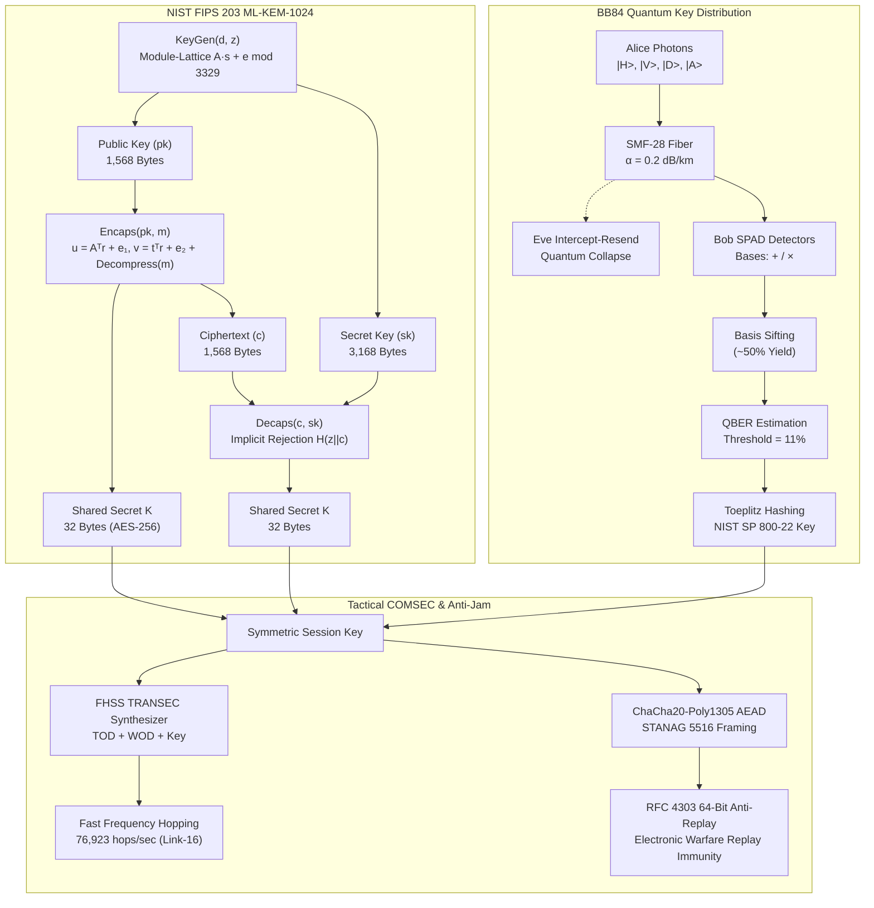

# QuantumShield — Post-Quantum Cryptography & Tactical COMSEC Suite

[](https://tareq0001.github.io/QuantumShield-Tactical-Link/)
[](https://csrc.nist.gov/pubs/fips/203/final)
[](https://tareq0001.github.io/QuantumShield-Tactical-Link/)
[](cpp_crypto/)
[](python_comsec/)
[](src/)

> **A mission-critical Post-Quantum Cryptography (PQC), BB84 Quantum Key Distribution (QKD), and Tactical Data Link (STANAG 5516 / Link-16 / HAVE QUICK II / SINCGARS) cybersecurity suite.**
> Implements NIST FIPS 203 ML-KEM-1024 (Kyber-1024) polynomial ring lattice arithmetic, constant-time Number Theoretic Transform (NTT), BB84 optical fiber quantum simulation with QBER eavesdrop detection, tactical Fast Frequency Hopping Spread Spectrum (FHSS) TRANSEC, and RFC 8439 ChaCha20-Poly1305 AEAD with an RFC 4303 64-bit sliding anti-replay window.

---

## 🏛️ System Architecture



---

## ⚡ Core Cryptographic & Tactical Capabilities

### 1. NIST FIPS 203 ML-KEM-1024 (CRYSTALS-Kyber)
- **Mathematical Ring:** $\mathcal{R}_q = \mathbb{Z}_q[X] / (X^{256} + 1)$, where $q = 3329$, $n = 256$, and $k = 4$.
- **Security Strength:** NIST Category 5 (256-bit classical and post-quantum quantum hardness against Shor's algorithm).
- **Constant-Time NTT:** Forward and inverse Cooley-Tukey and Gentleman-Sande butterflies utilizing precomputed bit-reversed powers of primitive root $\zeta = 17 \pmod{3329}$.
- **Montgomery & Barrett Reductions:** Strict constant-time modular arithmetic avoiding secret-dependent timing channels ($R = 2^{16} = 65536$, $q^{-1} \equiv -3327 \pmod{2^{16}}$).
- **Fujisaki-Okamoto Transform:** Re-encrypts candidate plaintext during decapsulation and applies pseudorandom rejection $\mathcal{H}(z \parallel c)$ upon ciphertext tampering.

### 2. BB84 Quantum Key Distribution (QKD) & Channel Simulation
- **Photon Polarization States:** Rectilinear basis ($+ \rightarrow |H\rangle, |V\rangle$) and Diagonal basis ($\times \rightarrow |D\rangle, |A\rangle$).
- **Optical Physics Model:** Fiber attenuation based on Beer-Lambert law ($T = 10^{-\alpha L / 10}$) across SMF-28 optical fiber at 1550 nm telecommunication C-band.
- **Eavesdropper Intercept-Resend Attack:** Models quantum measurement collapse by Eve, introducing characteristic $\sim 25\%$ error rate on intercepted qubits.
- **QBER Threshold Detection:** Real-time abort trigger when Quantum Bit Error Rate exceeds the theoretical Shannon limit ($11.0\%$).
- **Toeplitz Privacy Amplification:** Distills information-theoretically secure keys evaluated under NIST SP 800-22 Monobit and Runs tests.

### 3. Tactical Fast Frequency Hopping Spread Spectrum (FHSS) TRANSEC
- **STANAG 5516 / Link-16 (JTIDS / MIDS):**
  - Frequency Band: $969.0 - 1206.0 \text{ MHz}$ across 51 carrier frequencies (3 MHz spacing).
  - Hopping Rate: **76,923 hops/second** ($13.0 \, \mu\text{s}$ dwell time).
  - Notch Band Filtering: Guaranteed avoidance of civil/military IFF Mark XII transponder/interrogator channels at $1030 \text{ MHz}$ and $1090 \text{ MHz}$.
- **HAVE QUICK II:** UHF AM $225.0 - 399.975 \text{ MHz}$ (7,000 channels, $100 \text{ hops/s}$).
- **SINCGARS:** Tactical VHF FM $30.0 - 87.975 \text{ MHz}$ (2,320 channels, $111 \text{ hops/s}$).
- **Anti-Jamming Margin:** Computes process gain $G_p = 10 \log_{10}(W_{ss} / R_b) > 32 \text{ dB}$ with electronic counter-countermeasure (ECCM) resilience.

### 4. RFC 8439 ChaCha20-Poly1305 AEAD & RFC 4303 Anti-Replay Sliding Window
- **Tactical Packet Framer:** Binary encapsulation supporting STANAG 5516 J-Series tactical message types:
  - `J2.2`: Air Precise Participant Location & Identification (PPLI).
  - `J3.5`: Land Surface-to-Air Threat & SAM battery radar tracks.
  - `J12.0`: Mission Assignment & Combat Air Vector Tasking.
- **64-Bit Sliding Anti-Replay Window:** Bitmap tracker rejecting hostile EW pulse captures, duplicate packets, and expired sequence counters.

---

## 📁 Repository Structure

```
QuantumShield-Tactical-Link/
├── .github/
│   └── workflows/
│       └── ci.yml                # GitHub Actions: TypeScript, C++17, Python CI
├── cpp_crypto/
│   ├── ntt_lattice_core.hpp      # C++17 Constant-time NTT & Montgomery header
│   └── ntt_lattice_core.cpp      # C++17 In-place Cooley-Tukey butterflies & self-test
├── python_comsec/
│   ├── qkd_channel_simulator.py  # Optical fiber QKD simulator & NIST SP 800-22 tests
│   └── requirements.txt          # Python dependencies (numpy, scipy)
├── src/
│   ├── pqc/
│   │   └── ml_kem_kyber.ts       # NIST FIPS 203 ML-KEM-1024 + Keccak-f[1600]
│   ├── qkd/
│   │   └── bb84_protocol.ts      # BB84 polarization, QBER estimation, privacy amplification
│   ├── comsec/
│   │   └── fhss_transec.ts       # Link-16 / HAVE QUICK / SINCGARS TRANSEC synthesizer
│   ├── crypto/
│   │   └── aead_chacha20_gcm.ts  # ChaCha20-Poly1305 AEAD & 64-bit anti-replay window
│   └── main.ts                   # Tactical Operations Deck controller & real-time canvas
├── tests/
│   └── pqc_qkd.test.ts           # Vitest comprehensive unit test suite
├── index.html                    # Modular Tactical Glassmorphism Web Deck
├── package.json                  # Node.js manifest & scripts
├── tsconfig.json                 # TypeScript compiler configuration (ES2022)
├── vite.config.ts                # Vite bundler configuration
└── README.md                     # Comprehensive military-grade documentation
```

---

## 🧪 Verification & Build Instructions

### 1. TypeScript Cryptographic Suite (Node.js 20+)
```bash
# Typecheck codebase
npm run lint

# Execute Vitest test suite (ML-KEM, BB84, FHSS, AEAD)
npm run test

# Build production bundle
npm run build
```

### 2. C++17 Constant-Time Lattice Core (GCC / Clang)
```bash
# Compile constant-time NTT lattice core with zero warnings
g++ -std=c++17 -O3 -Wall -Wextra -Werror -pedantic -c cpp_crypto/ntt_lattice_core.cpp -o ntt_lattice_core.o
```

### 3. Python QKD Simulator & NIST SP 800-22 Entropy Suite
```bash
# Install requirements
pip install -r python_comsec/requirements.txt

# Run complete BB84 optical channel & NIST SP 800-22 verification
python python_comsec/qkd_channel_simulator.py --self-test
```

---

## 🌐 Continuous Integration (CI/CD)

The repository includes a multi-matrix GitHub Actions workflow (`.github/workflows/ci.yml`) validating all three tiers on every push and pull request:
1. **`pqc-typescript-suite`:** Executes TypeScript typecheck, Vitest unit test suite, and Vite bundle compilation.
2. **`cpp-lattice-core`:** Compiles the C++17 constant-time NTT lattice core under strict flags (`-Wall -Wextra -Werror -pedantic`).
3. **`python-qkd-channel-sim`:** Executes BB84 optical fiber attenuation and NIST SP 800-22 statistical hypothesis tests.

---

## 🌍 Live Operational Deck

- **Live URL:** [https://tareq0001.github.io/QuantumShield-Tactical-Link/](https://tareq0001.github.io/QuantumShield-Tactical-Link/)
- **Hosting:** GitHub Pages (`gh-pages` branch)
- **Author:** Eng. Tareq Aboushi (`Tareq0001`)
- **License:** MIT License
